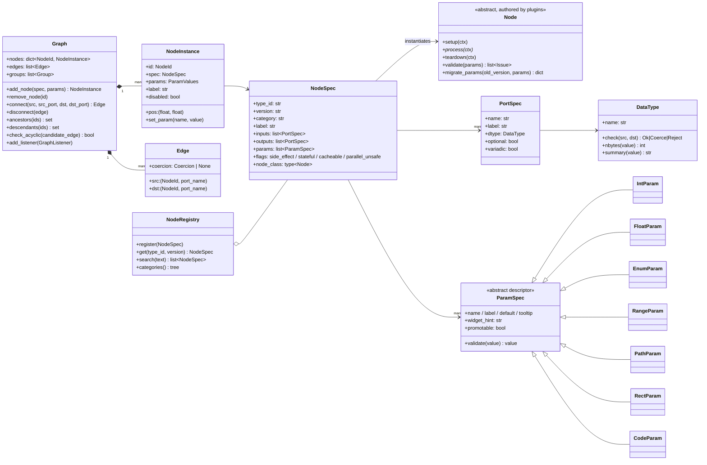
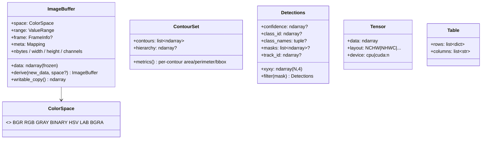
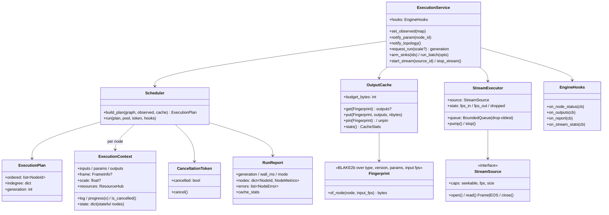
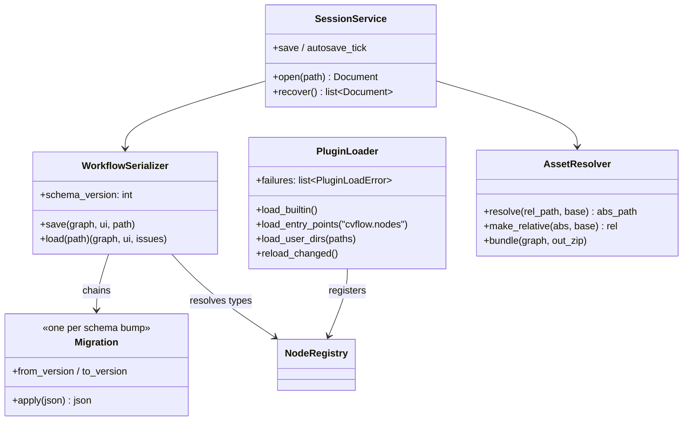
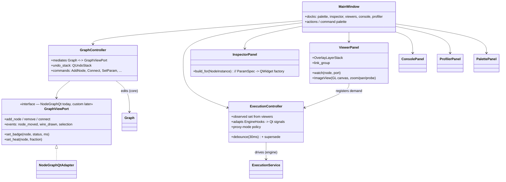
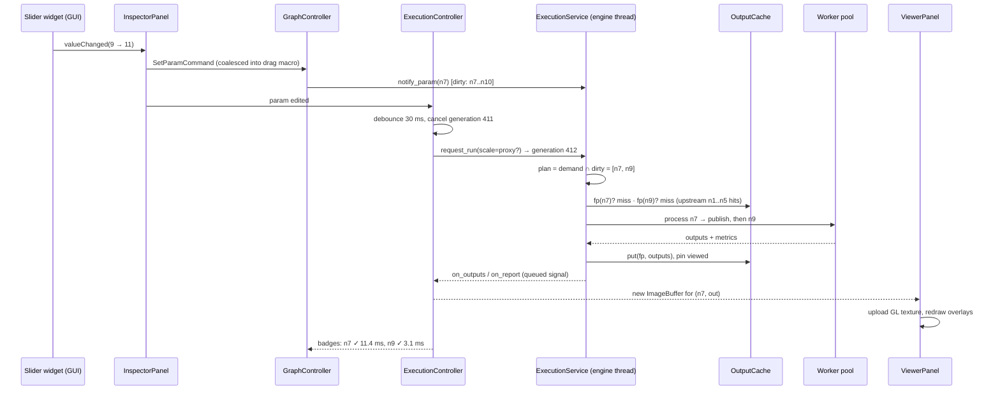

# 07 — Class Diagrams

Mermaid diagrams (render on GitHub / VS Code). These show the load-bearing classes and
relationships, not every helper. Cross-references: behavior in docs/02 (engine), docs/03
(types), docs/04 (plugin API), docs/05 (GUI).

---

## 1. Core model (`cvflow.core`)

## 2. Type system payloads (`cvflow.core.types`)

## 3. Engine (`cvflow.engine`)

## 4. Plugins & persistence

## 5. GUI (Qt layer — adapters around the headless core)

## 6. Sequence — a slider movement (the core loop, end to end)

